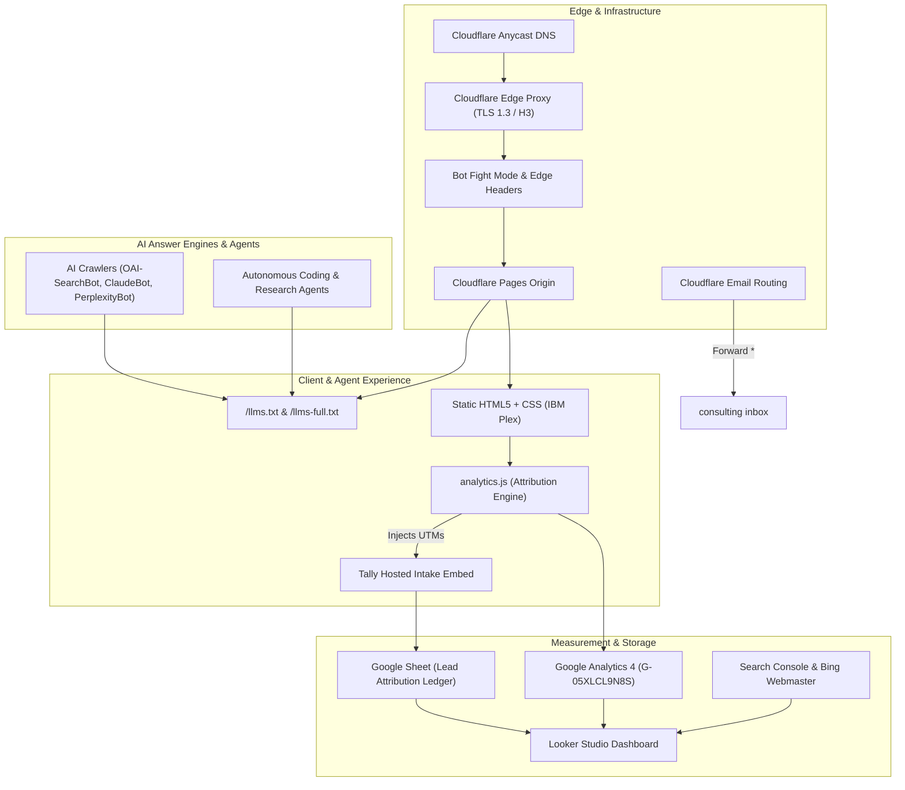
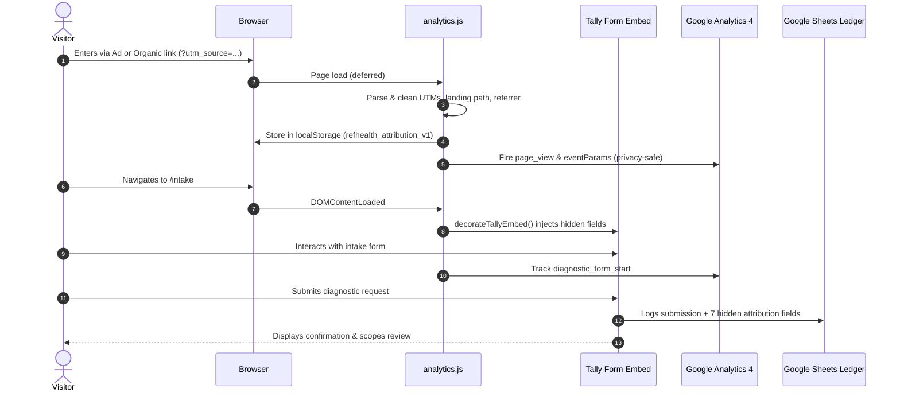

# ARCHITECTURE — refhealth.consulting

## System Overview

`refhealth.consulting` is a high-performance, privacy-compliant static web application and commercial conversion engine for executive healthcare data leadership (Fractional VP of Data), Company Data AI Operating Systems (HDAIOS), and healthcare analytics engineering.

The system is designed for zero runtime maintenance, maximum edge speed (<50ms TTFB globally), resilient security boundaries, and automated attribution without third-party tracking cookies or client-side bloat.



---

## Component Architecture

### Healthcare Feed Triage local extension

`feed-triage.html` is the public landing page and `.mcpb` download. The package
contains `mcp/server.mjs`, `mcp/feed-core.mjs`, synthetic CSV and FHIR Bundle
samples, a manifest, and bundled Node dependencies. Claude Desktop runs the
server locally over stdio. The single `inspect_healthcare_feed` tool reads an
explicit local CSV or JSON path, or defaults to the synthetic CSV. Files are
limited to 10 MB and 20,000 rows or Bundle entries. The server makes no
network calls.

For CSV, the core validates required fields and timezone-aware timestamps,
excludes invalid or repeated IDs, and calculates event-to-receipt latency
against a configurable target. For a FHIR Bundle, it checks Encounter IDs,
patient references within the supplied file, and period end times. It does
not infer receipt time from FHIR `meta.lastUpdated`. Tool results contain
aggregate counts and up to 30 row-numbered findings, without raw records or
identifiers. Claude receives those findings, so the intended input is
synthetic or approved de-identified data. A bundle build script creates the
archive and CI compares its files against source. GA4 records only the
download click, without file paths or data.
When a result has findings, the server adds a fixed investigation-guide URL to
the tool result. The link contains attribution tags but no feed content or file
path. The server does not open it; Claude may present it to the user, who can
choose whether to visit the page.
An extension-only public repository at
`https://github.com/apratsunrthd/refhealth-feed-triage` carries the MIT-licensed
source and tests. This site's `.mcpb` is the public download; release metadata
points to that repository and the extension privacy page.

### 1. Edge & Hosting Layer (Cloudflare)
* **Domain Registrar**: Cloudflare Registrar (migrated from Namecheap on 2026-09-20). Operates at wholesale at-cost renewal with registry transfer lock enabled (`clientTransferProhibited`).
* **Authoritative DNS**: Cloudflare Anycast nameservers (`barbara.ns.cloudflare.com`, `damien.ns.cloudflare.com`) with CNAME flattening at apex.
* **Edge CDN & Network**:
  * Full TLS 1.3 encryption with Google Trust Services origin certificates.
  * HTTP/2 and HTTP/3 (QUIC) enabled globally.
  * **Always Use HTTPS**: Native edge rule enforcing 301 redirection from HTTP to HTTPS.
  * **Bot Fight Mode**: Actively challenges automated scrapers and cloud IP crawler sweeps before they reach origin.
* **Hosting Origin**: Cloudflare Pages (`refhealth-consulting` project) serving custom domains `refhealth.consulting` and `www.refhealth.consulting`.
  * **Pretty URLs**: Native 308 redirection from legacy `.html` endpoints to clean URL paths.
  * **404 Routing**: Native fallback to `404.html` with `HTTP/2 404 Not Found` response code, eliminating soft 404s.
* **Edge Headers (`_headers`)**:
  * `Strict-Transport-Security: max-age=31536000; includeSubDomains; preload` (HSTS).
  * `X-Frame-Options: SAMEORIGIN` (prevents clickjacking).
  * `X-Content-Type-Options: nosniff`.
  * `Referrer-Policy: strict-origin-when-cross-origin`.
  * `Permissions-Policy: accelerometer=(), camera=(), geolocation=(), microphone=(), payment=(), usb=()`.
  * Granular caching: `public, max-age=0, must-revalidate` for HTML; `public, max-age=31536000, immutable` for static CSS/SVG/PNG assets.
* **Email Routing**:
  * Catch-all route (`*@refhealth.consulting` $\rightarrow$ `refhealth.consulting@gmail.com`).
  * Cloudflare published MX records (`route1-3.mx.cloudflare.net`), SPF (`include:_spf.mx.cloudflare.net`), and DKIM (`cf2024-1._domainkey`).

---

### 2. Frontend & Design System
* **Stack**: Semantic HTML5 and vanilla modern CSS. No JavaScript frameworks, runtime dependencies, or client build bundles.
* **Design System (`DESIGN.md`)**:
  * Aesthetic: "Company Data AI Operating System".
  * Palette: Cool paper (`#edf1ef`), strong paper (`#fbfcf6`), near-black ink (`#11100e`), with signal red (`#d1392d`), signal amber (`#d69a24`), and signal green (`#19795b`) indicating governance and readiness states.
  * The **No Default Healthcare Blue** rule: avoids generic healthcare gradients in favor of operational, senior visual discipline.
  * Typography: `IBM Plex Sans` for executive argument; `IBM Plex Mono` for status markers, numbers, and system layers.
  * Radius: 6px control surfaces with tactile `:active` press states.
* **Brand Assets**: Custom SVG favicon (`favicon.svg`), PWA webmanifest (`site.webmanifest`), and deterministic 1200x630 social preview card (`og.png` / `og-card.svg`).

---

### 3. Attribution & Commercial Conversion Flow



* **Attribution Engine (`analytics.js`)**:
  * Intercepts allow-listed UTM keys (`utm_source`, `utm_medium`, `utm_campaign`, `utm_content`, `utm_term`), the landing path, and referring host.
  * Stores first-touch and last-campaign attribution in `localStorage` (`refhealth_attribution_v1`).
  * Tracks high-intent interactions: `diagnostic_cta_click`, `diagnostic_form_start`, and `contact_email_click`.
* **Hosted Intake (`intake.html`)**:
  * Hosted via Tally (`https://tally.so/r/5BJOVN`) in a sandboxed iframe.
  * Form automatically inherits hidden attribution fields from `analytics.js`.
  * Plain-text email fallback (`contact@refhealth.consulting`) placed directly above embed.
  * Direct webhook connection pushes completed inquiries into the `refhealth lead attribution` Google Sheet.
* **Operating Dashboard**:
  * Unified Google Looker Studio report combines GA4 active users, Google Search Console query impressions/clicks, and Tally intake counts.

---

### 4. CI/CD & Deployment Pipeline

* **Repository**: GitHub private repository `apratsunrthd/refhealth.consulting`.
* **CI/CD Workflow (`.github/workflows/sitemap.yml`)**:
  1. **Trigger**: Push to branch `main`.
  2. **Sitemap Generation**: Generates `sitemap.xml` via `cicirello/generate-sitemap@v1`.
  3. **Analytics Validation**: Injects GA4 snippet across any newly added pages via `inject-ga.js`.
  4. **Auto-commit**: Commits updated `sitemap.xml` with `[skip ci]`.
  5. **IndexNow Ping**: Sends updated URL array to `https://api.indexnow.org/indexnow` for immediate Bing/Yandex change notifications.
  6. **Edge Deploy**: Deploys workspace directly to Cloudflare Pages via `cloudflare/wrangler-action@v3` using repository secrets `CLOUDFLARE_API_TOKEN` and `CLOUDFLARE_ACCOUNT_ID`.
* **Deployment Policy**: Standing branch $\rightarrow$ commit $\rightarrow$ PR $\rightarrow$ squash-merge $\rightarrow$ deploy workflow. Direct commits to `main` are prohibited.

---

### 5. Key Technical Decisions & Tradeoffs

| Decision | Alternative Considered | Rationale |
| :--- | :--- | :--- |
| **Static HTML/CSS without Framework** | Next.js, Astro, Hugo | Eliminates node runtime vulnerabilities, dependency drift, hydration delays, and server maintenance. Instant build and deploy. |
| **Cloudflare Pages over GitHub Pages** | GitHub Pages, Vercel | Native edge header control (`_headers`), automatic 308 pretty URLs, DDoS mitigation, unmetered edge requests, and co-location with Cloudflare DNS and Registrar. |
| **Tally Iframe with Hidden Fields** | Custom backend API, Formspree | Zero backend code or database to maintain; native webhook to Google Sheets; complies with strict healthcare zero-PHI collection policy. |
| **Edge Bot Fight Mode Challenge** | WAF rate-limiting, CAPTCHAs | Automatically filters automated cloud scraper sweeps (e.g. proxy scans) using lightweight JS challenges without degrading real human UX. |
| **Privacy-Bounded Attribution** | Full session replays (Hotjar, FullStory) | Healthcare consulting requires absolute data hygiene. No keystrokes, personal data, or form inputs are ever captured in analytics. |
| **LLM Agent Manifests (`/llms.txt`)** | HTML-only crawling | Provides token-dense, clean markdown with exact service definitions, pricing, and technical articles, avoiding DOM bloat for AI agents. |
| **Wikidata Entity Grounding** | Plain text keywords in JSON-LD | Directly links ref(health) capabilities to canonical semantic entities (dbt Q111974751, HIPAA Q1785501, FHIR Q16974868) in Google/Perplexity knowledge graphs. |

---

### 6. AI Agent & Answer Engine Discovery Architecture

To establish `refhealth.consulting` as the definitive authority when evaluated by autonomous LLM agents (ChatGPT Search, Perplexity, Claude, Gemini, coding agents), the site implements an end-to-end agent discoverability stack:

1. **Standardized Agent Manifest (`/llms.txt`)**:
   - Conforms to the `llmstxt.org` specification.
   - Provides a concise, markdown-formatted catalog indexing core services, the $2,500 diagnostic, technical articles, and direct citations.
2. **Comprehensive Token-Dense Corpus (`/llms-full.txt`)**:
   - Unabridged markdown containing the full text of all service scopes, the 5-layer Data AI Operating System framework, all 4 technical articles, and a targeted Q&A directory for instant context injection.
3. **Explicit Agent Crawler Permissions (`robots.txt`)**:
   - Dedicated User-Agent directives authorizing `OAI-SearchBot`, `GPTBot`, `ChatGPT-User`, `ClaudeBot`, `anthropic-ai`, `PerplexityBot`, `Google-Extended`, `Applebot-Extended`, and `Meta-ExternalAgent`.
4. **Edge Content Negotiation (`_headers`)**:
   - Explicit `Content-Type: text/plain; charset=utf-8` and 1-hour cache revalidation headers for both agent files.
5. **Entity-Grounded Schema.org Knowledge Graph**:
   - High-fidelity JSON-LD on `index.html` and service pages with `@type: ["Organization", "ProfessionalService"]`.
   - `knowsAbout` explicitly resolves to canonical Wikidata and Wikipedia entities (e.g. `dbt`, `Health care analytics`, `HIPAA`, `HL7 FHIR`, `Artificial intelligence in healthcare`).
   - Every service page embeds `@type: FAQPage` question/answer blocks and explicit `$2,500 USD` offer pricing.

---

### 7. Healthcare Data AI Operating System (HDAIOS) v1.0 Architecture

The site publishes and serves the canonical open specification for HDAIOS v1.0 at `/hdaios.html` and `/hdaios.md` (with edge `text/plain; charset=utf-8` delivery). HDAIOS structures healthcare data and generative AI systems into 5 decoupled, verifiable layers:

```mermaid
flowchart TD
    subgraph Layer 1: Decision Interface (DI)
        DEC["Decision Owner & Metric Baseline"]
        RISK["Risk Tiering & Clinical Safety Boundary"]
    end

    subgraph Layer 2: Governed Data Foundation (GDF)
        RAW["Raw Ingestion (EHR, Claims, EDI 837/835)"]
        SCD2["SCD Type 2 Bitemporal Warehouse Models"]
        DBT["refhealth-dbt-healthcare-checks (7 Integrity Tests)"]
    end

    subgraph Layer 3: Enterprise BAA & Model Gateway (EBMG)
        GATEWAY["Model Gateway (Bedrock, Azure OpenAI, Vertex AI)"]
        BAA["Signed Enterprise BAAs & Cloud Commitments"]
        ROUTER["Intent & Latency Router (Claude, GPT, Gemini)"]
    end

    subgraph Layer 4: Agent & Semantic Orchestration (AWO)
        SEM["Governed Metric Layer (Semantic Layer RAG)"]
        HITL["Human-in-the-Loop Tripwires"]
        AGENT["Specialized Operational Agents"]
    end

    subgraph Layer 5: Continuous Operational Cadence (COC)
        DRIFT["Data & Model Drift Monitoring"]
        CADENCE["90-Day Executive Review Cadence"]
    end

    DEC --> RAW
    RAW --> SCD2 --> DBT --> SEM
    SEM --> AGENT
    GATEWAY --> ROUTER --> AGENT
    BAA -.-> GATEWAY
    AGENT --> HITL
    DRIFT --> CADENCE
    CADENCE -.->|Feedback Loop| DEC
```

1. **Layer 1: Decision Interface & Clinical Safety Boundary**:
   - Establishes identifiable executive decision ownership, baseline metrics (turnaround, error rates, human toil), and operational risk tiering.
   - Enforces a hard clinical safety boundary: uncertified frontier LLMs are strictly prohibited from performing autonomous clinical diagnoses, patient triage, or prescription recommendations without formal regulatory clearance.
   - Restricts AI agent execution to administrative efficiency, operational coordination, payer/provider data transformation, and analytics engineering pipelines, preserving licensed clinician judgment.
2. **Layer 2: Governed Data Foundation (Bitemporality & dbt Integrity)**:
   - Claims processing lag (48h clearinghouse to multi-week payer cycles) mandates Slowly Changing Dimensions (SCD) Type 2 bitemporality. Queries track both Event Time (`date_of_service`) and System Knowledge Time (`received_date`, `paid_date`).
   - Integrates the open-source `refhealth-dbt-healthcare-checks` package (`https://github.com/apratsunrthd/refhealth-dbt-healthcare-checks`) enforcing 7 generic tests: surrogate key uniqueness, CMS NPI formatting, ICD-10 validity, HCPCS/CPT validity, midnight timestamp audits, bitemporal enrollment consistency, and referential integrity.
3. **Layer 3: Enterprise BAA & Model Gateway**:
   - Capitalizes on existing enterprise cloud commitments (AWS Bedrock, Azure OpenAI, GCP Vertex AI) under executed Business Associate Agreements (BAAs).
   - Treats frontier models (Claude, OpenAI, Gemini) as interchangeable commodities routed dynamically based on token economics and latency rather than vendor lock-in.
4. **Layer 4: Agent & Workflow Orchestration**:
   - Grounds autonomous agent tool-calling strictly through governed semantic metrics rather than unconstrained raw SQL generation over raw tables.
   - Enforces mandatory human-in-the-loop (HITL) review gates on high-risk workflows (claims appeals, payment adjustments, provider disputes).
5. **Layer 5: Continuous Operational Cadence**:
   - Automated monitoring of upstream claims lag shifts, EHR format drift, and model output stability.
   - Structured 90-day executive operating cadence reviewing data quality pass rates, token utilization, and workflow automation ROI.

---

### 8. Interactive Client-Side Calculators & Open-Source Artifacts

To demonstrate engineering authority and provide zero-friction conversion tools for prospects without collecting sensitive PHI, `refhealth.consulting` deploys three native client-side calculators:

1. **Claims Lag & Capital Float Calculator (`dbt-consulting.html#calculator`)**:
   - Computes unadjudicated capital float tied up in clearinghouse transit, annual clerical rework drag, and monthly MLR volatility bands based on monthly volume, turnaround lag days, and first-pass denial rates.
   - Synthesizes 1-click executive Markdown briefing memos and pre-fills scope parameters dynamically into `intake.html`.
2. **Diagnostic Statement of Work (SOW) Generator (`ai-readiness-assessment.html#scope-generator`)**:
   - Synthesizes prospective stack parameters (Snowflake, BigQuery, Databricks, PostgreSQL, DuckDB), ingestion feeds, and friction points into an executive budget memo.
   - Enables 1-click clipboard copy, `.md` download, and pre-populated routing to the diagnostic intake.
3. **HDAIOS Self-Assessment Tool (`hdaios.html#assessment`)**:
   - Zero-PHI 10-question evaluation widget assessing technical posture across all 5 HDAIOS layers.
   - Yields architecture risk tiering (Production Ready, Emerging Foundation, High-Risk Pilot) and prioritized remediation gap checklists.
4. **Open-Source Healthcare dbt Starter Repo (`apratsunrthd/refhealth-starter-dbt-project` v1.2.0)**:
   - Zero-dependency local DuckDB test suite with 106/106 automated tests passing out of the box.
   - Features synthetic FHIR Encounter-to-Claims Transformation Bridge (`int_encounter_claims_crosswalk.sql`), statutory ACA MLR calculation standards, and bitemporal enrollment models.


