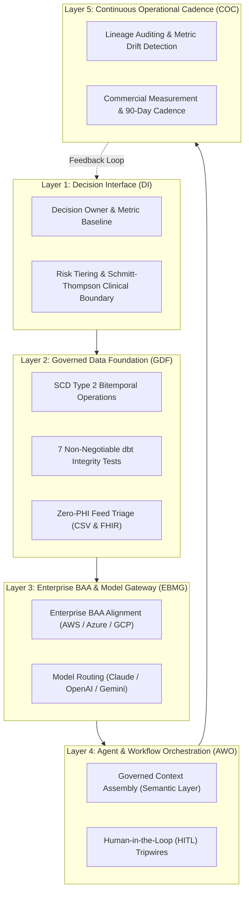

# Healthcare Data AI Operating System (HDAIOS) Specification

**Version:** 1.0.0  
**Status:** Stable / Reference Architecture  
**Author:** ref(health) Consulting (<https://refhealth.consulting>)  
**Canonical URI:** <https://refhealth.consulting/hdaios.md>  
**Interactive Reference:** <https://refhealth.consulting/hdaios.html>  

---

## 1. Abstract & Motivation

Healthcare organizations frequently struggle to transition from isolated generative AI experiments (one-off prompt wrappers, disconnected chatbots, ad-hoc copilot trials) to an institutional, repeatable, and compliant operating capability. 

The **Healthcare Data AI Operating System (HDAIOS)** is a 5-layer architectural specification designed to connect business decisions, governed data products, cloud-native model commitments, human-in-the-loop agent workflows, and operational measurement into a unified operating standard.

---

## 2. Layer 1: The Decision Interface (DI)

Every AI initiative must begin with a defined business decision, a designated operational owner, and clear regulatory boundaries before a single prompt or pipeline is authored.

### 1.1 Specification Requirements
* **Decision Ownership**: An identifiable executive or operational manager must own the decision outcome, baseline performance metrics, and acceptable risk profile.
* **The Clinical Boundary Rule (Schmitt-Thompson Protocol Standard)**:
  * Industry-standard clinical guidelines (specifically Schmitt-Thompson clinical telephone triage protocols) govern medical triage.
  * *Constraint*: Unless an organization operates a certified, clinical-grade platform subject to formal clinical validation, autonomous LLM agents are **strictly prohibited** from performing clinical diagnoses or triage recommendations.
  * *Allowed Scope*: AI agents must be bounded to administrative efficiency, operational coordination, care navigation guidance, unstructured feed extraction, and structured data engineering, preserving licensed clinician judgment.
* **Success Metric Baseline**: Pre-implementation baselines must be recorded for task turnaround time, error rates, and human toil prior to deploying model assistance.

---

## 3. Layer 2: The Governed Data Foundation (GDF)

AI models cannot reason accurately over fragmented, undocumented, or unverified data foundations. Layer 2 enforces strict data contracts, bitemporal modeling, and automated data testing.

### 2.1 Bitemporal Data Operations (SCD Type 2)
Claims and clinical events are subject to clearinghouse batching, retrospective payer adjustments, voids, and denials. HDAIOS mandates that healthcare data platforms enforce bitemporal operations via Slowly Changing Dimensions (SCD Type 2):
* **Event Time (Date of Service)**: Encodes the clinical encounter and patient experience.
* **Transaction Time (Adjudication / Paid Date)**: Encodes financial settlement, queue latency, and payment accuracy.
* **Knowledge Time (Pipeline Ingestion Date)**: Encodes when the warehouse first observed the record.
* *Rule*: Analytical queries and LLM prompts querying historical state must use bitemporal snapshot filters to prevent retrospective hallucinations and future-knowledge leakage.

### 2.2 The 7 Non-Negotiable dbt Tests
All models feeding downstream analytics or AI agents must implement the [refhealth-dbt-healthcare-checks](https://github.com/apratsunrthd/refhealth-dbt-healthcare-checks) generic test suite:
1. `bitemporal_enrollment_consistency`: Validates chronological precedence across effective, enrollment, and updated dates.
2. `surrogate_key_grain`: Enforces zero nulls and zero duplicates across composite claims line item grains.
3. `cms_npi_format`: Validates 10-digit numeric formatting and prefix rules against CMS NPPES registry specifications.
4. `icd10_code_validity`: Validates diagnosis code structures against ICD-10-CM / ICD-10-PCS formatting standards.
5. `hcpcs_cpt_code_validity`: Validates procedure codes against 5-character CPT Category I/II/III and HCPCS Level II standards.
6. `midnight_default_timestamp`: Audits timestamps to detect where upstream sources dropped time precision and defaulted to `00:00:00`.
7. `claim_member_referential_integrity`: Enforces referential integrity between claim dates of service and active member enrollment windows.

### 2.3 Stream Pre-Flight Inspection
Incoming external vendor feeds must undergo deterministic pre-flight inspection (such as [refhealth-feed-triage](https://github.com/apratsunrthd/refhealth-feed-triage)) locally to verify delivery latency, schema conformance, and duplicate rates without exposing unverified PHI.

---

## 4. Layer 3: Enterprise BAA & Model Gateway (EBMG)

Layer 3 governs model selection, enterprise security boundaries, and token optimization.

### 3.1 The Model Parity Principle
Frontier model capabilities across leading providers (Anthropic Claude, OpenAI, Google Gemini) have converged for most operational and reasoning tasks. HDAIOS discourages academic model-benchmarking churn.

### 3.2 Cloud Commitment Optimization
The primary architectural directive is **maximizing the client's existing enterprise cloud commitment, signed Business Associate Agreement (BAA), and token allocation**:
* **AWS Environment**: Route through AWS Bedrock with signed BAA.
* **Microsoft Azure Environment**: Route through Azure OpenAI Service with enterprise compliance boundary.
* **Google Cloud Environment**: Route through Google Cloud Vertex AI under Google Workspace / GCP BAA.

### 3.3 Multi-Model Routing Rules
Multi-model orchestration is deployed selectively when tasks demonstrate divergent engineering constraints:
* **High-Speed Parsing / High-Volume Extraction**: Compact models (e.g., Gemini Flash, Claude Haiku, GPT-4o mini) for cost and latency minimization.
* **Complex Multi-Step Synthesis / Policy Evaluation**: Frontier reasoning models (e.g., Claude 3.5 Sonnet, GPT-4o, Gemini 1.5 Pro).
* **Multi-Million Token Chart Ingestion**: Massive context-window models (e.g., Gemini 1.5 Pro) for comprehensive longitudinal record reviews.

---

## 5. Layer 4: Agent & Workflow Orchestration (AWO)

Layer 4 operationalizes models into reliable workflows that empower human operators rather than replacing them.

### 4.1 Governed Context Retrieval
LLM agents must never execute arbitrary, unconstrained SQL queries against raw transactional schemas. Context retrieval must be mediated by:
* Verified semantic models and dbt metric definitions.
* Strict schema validation (e.g., JSON Schema / Pydantic models).
* Deterministic tool calling with explicit permission scopes.

### 4.2 Human-in-the-Loop (HITL) Escalation Tripwires
Every agent workflow must incorporate hard programmatic tripwires that immediately pause execution and route to a human supervisor:
* **Confidence Drop**: Model confidence or semantic similarity score below established threshold.
* **Data Discrepancy**: Conflicts between bitemporal claims records and member enrollment spans.
* **Financial Threshold**: Financial authorization or payment claim dispute exceeding configured dollar limits.
* **Clinical Boundary**: Any query touching clinical diagnosis, clinical triage, or acute symptoms immediately routes to licensed clinical staff.

---

## 6. Layer 5: Continuous Operational Cadence (COC)

An operating system requires continuous governance, measurement, and change control.

### 6.1 Lineage & Metric Drift Monitoring
* Continuous dbt test execution in CI/CD pipelines.
* Automated alerting when midnight default timestamp ratios or orphaned claim rates spike.
* Version-controlled prompt and context templates maintained in Git.

### 6.2 90-Day Review Cadence
Every HDAIOS deployment is evaluated on a recurring 90-day cadence:
1. **Commercial Value**: Hard hours saved, manual rework eliminated, and decision velocity improvements.
2. **Adoption & Operator Trust**: Feedback from data engineers, operations managers, and clinicians using the tools.
3. **Roadmap Prioritization**: Sequencing follow-on automation sprints based on measured ROI.

---

## 7. Implementation & Diagnostic Starter

Organizations adopting HDAIOS can begin with the **2-Week Healthcare AI Readiness Diagnostic** ($2,500 USD), which audits current pipeline blockers, bitemporal gaps, and clinical boundaries, delivering immediate execution scripts and dbt tests.

* **Documentation & Inquiry**: <https://refhealth.consulting/>
* **Diagnostic Intake**: <https://refhealth.consulting/intake.html>
* **Interactive Self-Assessment Tool**: <https://refhealth.consulting/hdaios.html#assessment>
* **Open Source Test Suite**: <https://github.com/apratsunrthd/refhealth-dbt-healthcare-checks>
* **Open Source Feed Triage Tool**: <https://github.com/apratsunrthd/refhealth-feed-triage>

